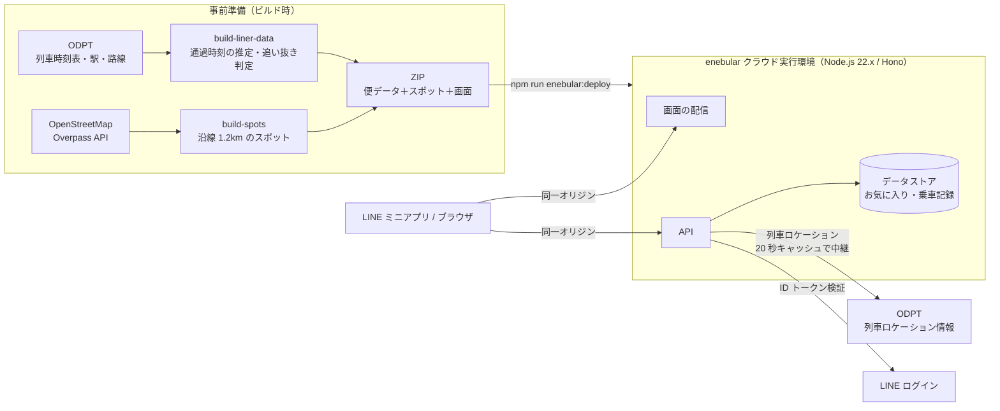

<!--
Qiita 投稿用ドラフト
タグ案: 公共交通オープンデータチャレンジ / ODPT / enebular / LINEミニアプリ / バイブコーディング
-->

# 京王ライナーが新宿に着くまでにアプリを作りきれ ── 乗車40分の縛りでバイブコーディングした話

:::note info
この記事で紹介するアプリ「ライナー車窓」は、**[公共交通オープンデータチャレンジ2026](https://developer.odpt.org/challengeinfo)** の応募作品です。京王電鉄の列車データは、公共交通オープンデータセンター（ODPT）がチャレンジ向けに提供している API を使っています。京王電鉄の公式アプリではありません。
:::

## はじめに：月1〜2回だけの「動く開発室」

普段はリモートワークで、出かけるのは近所の買い物やコンビニくらい。遠出はほとんどしません。
そんな私が都心まで出るのは、月に1〜2回の出社と、イベントに出向くときくらい。そしてそのとき、**橋本 → 新宿はほぼ必ず京王ライナー**です。

京王ライナー、いいんですよ。

- **座席指定の安心感**。座れるかどうかで朝の HP を削られない
- **新宿までが早い**。途中の停車駅が少ない
- **コンセントが使える**。もうこれは「PC を開け」と言われているのと同じ

ある日、いつものように座って窓の外を眺めていたら、気になりだしました。

> 「いま通過したの、何駅？」
> 「このライナー、新宿までに何本の電車を抜いてるんだろう」
> 「そもそも京王線の沿線って、何があるの？」

調べればいい。……いや、どうせなら**作ればいい**。
そして、ここで余計なスイッチが入りました。

:::note warn
**セルフ縛りルール**
橋本を発車してから新宿に着くまでの **約40分で、アプリを作りきる**。
新宿に着いたら PC を閉じる。延長戦なし。
:::

誰にも頼まれていません。

## 装備：座る席は、乗る前から決まっている

40分でゼロから全部書くのは無理です。なので、勝負は乗る前から始まっています。

| 装備 | 役割 |
| :--- | :--- |
| AI コーディングエージェント | 指示を出して、コードもテストもどんどん書いてもらう。いわゆるバイブコーディング |
| **enebular の事前準備（ハーネス）** | バックエンド（Node.js）・画面の配信・データストア・デプロイまでの雛形と手順を、AI がそのまま使える形で用意しておいた |
| **ODPT の API** | 京王電鉄の列車時刻表・駅情報・路線情報・列車ロケーション情報 |
| OpenStreetMap | 沿線のスポット（公園・寺社・競技場・川など） |
| **LINE ミニアプリ（LIFF）** | 配る先。車内でアプリをインストールしてもらうのは無理があるので、みんなのスマホに入っている LINE から開けるようにする |

京王ライナーが座席指定なのと同じで、**インフラの置き場所は乗る前から決まっている**。これが今回いちばん効きました。AI に「enebular のこの形で作って」と言えば、API の置き方もデプロイの仕方も迷わない。人間が迷う時間を、ぜんぶ乗車前に済ませておく作戦です。

## 車内実況：40分タイムアタック

### 発車〜南大沢：まずコンセントに挿す

ドアが閉まる。PC を開く。ACアダプタを座席のコンセントへ。ここまで 30 秒。

最初に AI に投げたのは、だいたいこんな指示です。

> ODPT の京王電鉄の時刻表から、京王ライナーの各便が途中で追い抜く列車を数えて

ところが、すぐに壁にぶつかります。

**京王ライナーの時刻表には、通過駅の時刻が入っていない。**

そりゃそうです。止まらない駅の時刻は時刻表に要らない。でも「どこで何を抜くか」を出すには、通過する時刻が要る。
そこで、前後の停車駅の時刻から**駅間距離で按分して通過時刻を推定**することにしました。

```js
// 停車駅 A（km=a.km, 時刻=a.t）と B のあいだにある通過駅 P の時刻を、距離の比で決める
const passTime = a.t + (b.t - a.t) * (p.km - a.km) / (b.km - a.km)
```

追い抜きの判定は、「**前の駅では相手が先に出ていて、次の駅ではライナーの方が先に出る**」列車を数えるだけ。シンプル。

### 京王多摩センター〜京王永山：数字が出て、声が出かける

ロジックができたので全便を回してみると……

- 京王ライナーは全部で **106 便**
- 1 便あたり **平均 3.6 本** を追い抜き（最大 6 本）
- 反対方向の列車とは **平均 22.5 本** すれ違う（最大 37 本）

すれ違い、そんなにあるの。思わず「えっ」と言いかけて飲み込みました。電車の中なので。

これは見せたい。画面のど真ん中に「追い抜きカウンター」と「すれ違いカウンター」を置くことに決定。
さらに「**あと 3 分、つつじヶ丘で各駅停車を追い抜き**」と予告を出して、抜いた瞬間に通知する仕様にしました。

### 若葉台〜京王多摩川：車窓ガイドと「地下で喋るな」問題

次は車窓。OpenStreetMap から線路の 1.2km 以内のスポットを拾ってきて、

> 右手・550m・京王閣

のように、**左右と距離つき**で出します。相模原線区間なら、よみうりランドや多摩川の鉄橋あたりが見どころです。スポットは全部で 245 件。

ここで気づきます。

**調布の前後と、笹塚から先の新宿までは地下。**

地下を走っている最中に「右手に見えますのは〜」と通知が来たら、ちょっとしたホラーです。窓の外は真っ暗なので。
急いで地下区間を定義して、**地下ではスポット通知を出さない**ようにしました。ちなみに ODPT の路線データには地下区間の情報がないので、ここは手で書いています。

```js
// 新宿〜笹塚は笹塚の手前まで地下。調布付近（国領・布田・調布）は 2012 年に地下化
const TUNNELS = {
  whole: [['新宿', '笹塚'], ['国領', '布田'], ['布田', '調布']],
  half: [['柴崎', '国領', '国領'], ['調布', '西調布', '調布'], ['調布', '京王多摩川', '調布']],
}
```

まさに今、自分が調布の地下を走りながら書いているという臨場感。

### 調布〜明大前：乗る前に知りたかった機能を、乗ってから作る

ふと思いました。

> 「座席指定を買う前に、**左右どっちの窓側が面白いか**分かったら便利じゃない？」

というわけで「**席の左右おすすめ**」カードを追加。左右それぞれの見どころと、渡る川を出します（地下区間のスポットは数えません）。

……ただ、この機能は今日の私の役には立ちません。座席指定券は、もう買ってしまったので。
**席を選ぶときに欲しかった機能を、その席に座って作っている。** 順番が完全に逆です。

### 笹塚〜新宿：地下に潜ったら、デプロイ

残り数分。ここで事前準備が火を噴きます。

```bash
npm run enebular:deploy
```

ZIP を作って、enebular のクラウド実行環境に上げる。この一発。
初回の環境づくりは乗る前に済ませてあったので、車内でやることはこれだけです。座る席が決まっていると、こんなに楽。

### 新宿着：PC を閉じる

ライナーが減速して、新宿のホームに入る。
スマホで開く。カウンターが動いている。

**動いた。**

荷物をまとめて PC を閉じたところで、ドアが開きました。
完走です。誰も見ていませんが。

## できあがったもの：「ライナー車窓」

京王ライナーの座席で過ごす時間を、窓の外を楽しむ時間に変える **LINE ミニアプリ**です。

LINE ミニアプリにしたのは、乗客のスマホにはたいてい LINE が入っているからです。アプリストアからインストールしてもらう必要がなく、リンクを開けばすぐ使えます。お気に入りや乗車記録は LINE ログインでそのまま自分のものとして保存されるので、会員登録の画面も作っていません。ログインしたくない人は、ブラウザから普通の Web アプリとしても開けます。

- **追い抜きカウンター**：この便が抜く列車を数え、「あと 3 分で〇〇を追い抜き」と予告して、抜いた瞬間に知らせる
- **すれ違いカウンター**：反対方向の列車とのすれ違いを数える
- **車窓ガイド・スポット通知**：この先のスポットを左手／右手と距離つきで並べ、近づいたら通知（地下では黙る）
- **席の左右おすすめ**：座席指定を選ぶ前に、左右どちらに何が見えるかを出す
- **お気に入り・乗車記録とバッジ**：LINE ログインで、気に入ったスポットを保存。乗った便は自動で記録されて、バッジ（13 種）が集まる
- **遅れの反映**：ODPT の列車ロケーション情報から遅れを取り込む
- **デモ再生**：京王ライナーは朝と夕方以降しか走らないので、昼間はデモ再生（×20）で動きを確かめられる

👉 LINE で開く：https://liff.line.me/2012257346-MWqgoKCP
👉 ブラウザで開く：https://lcdp005.enebular.com/keio-liner/
👉 デモ再生（便の発車 12 分後から）：https://lcdp005.enebular.com/keio-liner/?trip=Weekday-7003&demo=12

<!-- ここにスクリーンショット（乗車中画面・追い抜き通知・席の左右おすすめ） -->

### 構成



時刻表は乗車中に取りに行かず、ビルド時に便データへ変換して ZIP に同梱しています。ODPT のトークンは画面には渡さず、サーバだけが持っています。列車ロケーションもサーバ経由で中継します。

## ODPT のデータを使ってみて

チャレンジ提供データのおかげで、時刻表から「抜く・すれ違う」をここまで出せるのは本当に面白かったです。そのうえで、使ってみて気づいたことも書いておきます。

- **通過駅の時刻がない**：上に書いたとおり距離で按分して推定しています。通過時刻があると精度が上がります
- **1 レスポンス 1000 件で打ち切られる**：京王線は曜日区分ごとに分けて取得しました
- **地下区間・橋梁の情報がない**：車窓から見えるかどうかの判定は、手で定義しました

なお、チャレンジ提供データは応募作品以外への利用や第三者提供ができないライセンスなので、取得した生データと生成物はリポジトリに入れていません。

## 振り返り

1. **京王ライナーは開発環境として優秀すぎる**
   座れる、揺れが少ない、電源がある。そして「新宿に着いたら終わり」という絶対に延びない締め切りがある。人間は終点が見えると集中します。
2. **バイブコーディングは「事前準備」で決まる**
   40分で作りきれたのは、AI が速いからだけではありません。enebular の雛形とデプロイ手順を事前に用意して、**AI が迷わない場所**を作っておいたからです。座席指定と同じで、席が決まっていれば座るだけ。
3. **乗車中に作ると、仕様が自然に決まる**
   「地下で通知しない」も「席の左右おすすめ」も、実際に乗っていなければ思いつかなかった仕様です。現場（車内）で作るのは強い。

次の出社日は、たぶんこれを開いて窓の外を見ていると思います。PC は閉じたまま。……たぶん。

## 出典

- 公共交通オープンデータセンター（公共交通オープンデータチャレンジ2026 提供データ）：京王電鉄 列車時刻表・駅情報・路線情報・列車ロケーション情報
- © OpenStreetMap contributors（ODbL）
- 通過駅の時刻は駅間距離からの推定値です
